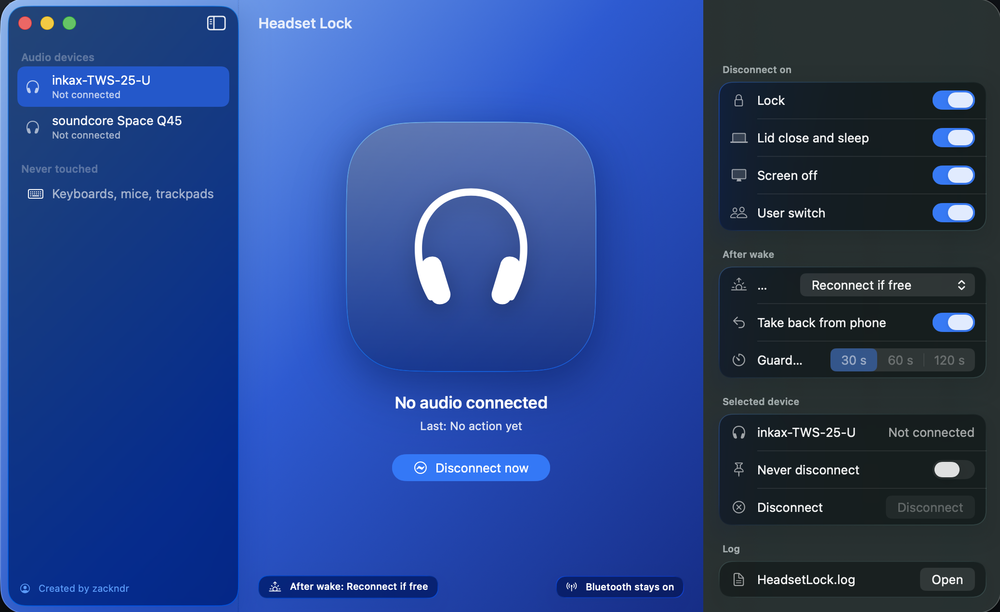

# Mac headset lock (v2)

Created by zackndr. LinkedIn: https://www.linkedin.com/in/zackndr/

A small menu bar app for your Mac. When you lock the Mac, close the lid or put it to sleep, it disconnects every Bluetooth audio device (headphones, AirPods, speakers) so they move to your phone. Keyboards, mice and trackpads stay connected. Bluetooth stays on.

Started 2026-10-26. v2 replaces a single-device v1. The full plan is in PLAN.md.

## Install (no building needed)

1. Download headset-lock-2.1.dmg from the latest release: https://github.com/znadaara/headset-lock/releases/latest
2. Double-click it. A window opens.
3. Open Terminal, type bash and a space, drag Install Headset Lock from that window into Terminal, press Return.
4. Click Allow when macOS asks about Bluetooth.

Comfortable with Terminal? This downloads and installs in one go:

    curl -fsSL -o /tmp/headset-lock.dmg https://github.com/znadaara/headset-lock/releases/latest/download/headset-lock-2.1.dmg && hdiutil attach -nobrowse /tmp/headset-lock.dmg && bash "/Volumes/Headset Lock 2.1/Install Headset Lock.command"

## Build and install from source

1. Open Terminal in this folder.
2. If you have never used Swift on this Mac, run: xcode-select --install
3. Run: ./build.sh --install
4. Allow Bluetooth access when macOS asks.
5. Look for the headphones icon in the menu bar.

The install copies the app to /Applications and adds a LaunchAgent at ~/Library/LaunchAgents/so.zackndr.headsetlock.plist. The app starts at login and restarts if it crashes. Quit from the menu stops it until your next login.

## What triggers a disconnect

- Lock (Control + Command + Q, lock button, hot corner)
- Lid close and sleep
- Screen off
- User switch

After a lock, the app checks again at 3 and 8 seconds in case a device reconnects.

## After wake

Pick one in the menu or the app window:

- Reconnect if free (default): when you open the lid or unlock, the Mac reconnects the earbuds it disconnected. If they are on your phone, they refuse, and the phone keeps them. The app tries at 1, 4 and 10 seconds.
- Keep them off (guard): for 30 seconds (or 60, 120) any audio device that reconnects by itself gets disconnected again.
- Do nothing.

Take back from phone when free (off by default, works with Reconnect if free, turn it on in the menu or the app window): if the earbuds are on your phone when you open the lid, the Mac keeps trying every 10 seconds for up to 1 hour. When you disconnect them from your phone, they come back to the Mac within about 10 seconds. It stops when they reconnect, when you lock or close the lid, or when you press Disconnect now.

Use Take back only with earbuds that connect to one device at a time. Earbuds that connect to two devices at once, and AirPods, may accept the Mac while they are on your phone and pull the call audio away.

Disconnect now never reconnects anything later.

## App window

Open it from the menu (Open Headset Lock…, Command + comma) or open the app again from Finder or Spotlight. On macOS 26 it uses Liquid Glass. On older macOS it uses frosted panels.

- Sidebar: your paired audio devices and whether each is connected.
- Center: how many audio devices are connected, the last action, Disconnect now, and the guard status.
- Inspector: switches for each trigger, After wake choice and guard time, Never disconnect and Disconnect for the selected device, and a button to open the log.

## Menu

- Last: what the app did last and when.
- Connected audio devices: each one has a Never disconnect option. Devices on that list stay connected.
- Toggles for each trigger, the After wake choice, and Guard time when the guard is on.
- Open Headset Lock…: opens the app window.
- Disconnect now: test without locking.
- Quit Headset Lock.

## Log

Every action goes to ~/Library/Logs/HeadsetLock.log as one line: time, trigger, device, result. Use it to check that lid close worked.

## Privacy and security

- The app only uses Bluetooth. It has no internet access and sends nothing anywhere.
- It collects no data. The log at ~/Library/Logs/HeadsetLock.log stays on your Mac and holds only times, device names and results.
- It stores your settings in its own preferences (so.zackndr.headsetlock) and adds one LaunchAgent so it starts at login.
- It never touches keyboards, mice or trackpads, and never turns Bluetooth off.
- The DMG is not signed by a registered Apple developer or notarized by Apple, so macOS warns you the first time. If you prefer, build it yourself from this source.

## Stop the Bluetooth prompt

macOS remembers your Bluetooth answer for one exact app signature. Without a certificate, build.sh signs ad-hoc, which gives every build a new signature, so macOS asks again after each rebuild. Make a free certificate once and build.sh uses it from then on:

1. Open Keychain Access. In the menu bar choose Keychain Access > Certificate Assistant > Create a Certificate.
2. Name: Headset Lock Signing. Identity Type: Self Signed Root. Certificate Type: Code Signing. Click Create.
3. Run ./build.sh --install. It prints "Signed with: Headset Lock Signing".
4. Allow Bluetooth one last time. Later rebuilds keep the permission.

This certificate is only for your own Mac. Other Macs do not know it and refuse to open an app signed with it, so ./build.sh --dmg always signs ad-hoc.

## Share it as a DMG

Run: ./build.sh --dmg

This makes build/headset-lock-<version>.dmg. It runs on Apple Silicon and Intel Macs. Send that file to a friend. They drag the app to Applications and open it. On first launch the app adds its own LaunchAgent, so it starts at every login. The DMG includes a Read Me First file with the steps, and Install Headset Lock: your friend types bash and a space in Terminal, drags the file in and presses Return. It installs the app, clears the download mark so macOS does not block it, and sets up start at login. No trip to Privacy and Security.

The app is not signed by a registered Apple developer, so macOS blocks it the first time. Your friend opens System Settings > Privacy and Security and clicks Open Anyway.

## Uninstall

Run: ./build.sh --uninstall

This unloads the LaunchAgent and moves the app and the LaunchAgent to the Trash.

## Notes

- Needs macOS 13 or newer.
- Each rebuild changes the app signature, so macOS asks for Bluetooth access again.
- If disconnect shows "failed", check System Settings > Privacy and Security > Bluetooth and turn on Headset Lock.
- With an external monitor plugged in, closing the lid does not sleep the Mac, so nothing fires.
- AirPods: also set System Settings > Bluetooth > AirPods (i) > Connect to This Mac > When Last Connected to This Mac.
- v2 removes the v1 Open at login item on first launch, because the LaunchAgent replaces it.

## Files

- src/: the app code (main, AppDelegate, AppModel, MainWindow, Reconnector, BluetoothManager, EventMonitor, ReconnectGuard, Settings, Logger).
- resources/Info.plist: app settings and the Bluetooth permission text.
- resources/so.zackndr.headsetlock.plist: the LaunchAgent.
- build.sh: builds build/Headset Lock.app. Use --install, --uninstall or --dmg.
- LICENSE: MIT.
- resources/dmg-read-me-first.txt: the install steps shipped inside the DMG.
- resources/install.command: the easy installer shipped inside the DMG.
- resources/AppIcon.icns: the app icon. tools/make-icon.swift draws it: swift tools/make-icon.swift
- PLAN.md: the v2 plan and checklist.
- originals/hammerspoon-guide.pdf: the old guide, unchanged.
